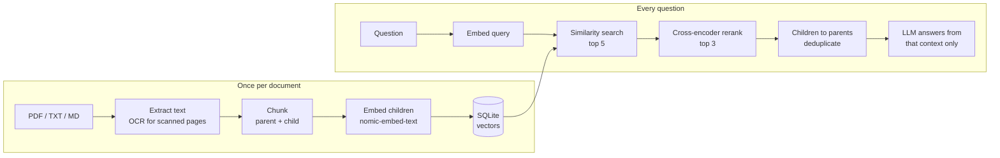

# RAG Retrieval Visualizer

**See what happens inside the retrieval half of a RAG system, one stage at a time.**

Most RAG demos show a question going in and an answer coming out. This project opens the box in between: how a document is split into chunks, turned into vectors, searched, reranked, and assembled into the context a language model finally reads. Every stage is its own button with its own output, so you can follow a question all the way through.

It runs entirely on your own machine (local models, no cloud API keys), which also makes it usable offline.


## How it works



| Stage | What happens |
|---|---|
| **Extract** | Text is read from the PDF's text layer; pages with no text layer are read with Tesseract OCR. |
| **Chunk** | Each document is split twice: large *parent* chunks (~1200 characters) for context, small *child* chunks (~300 characters) for precise search. "Search small, retrieve big." |
| **Embed** | Each child chunk becomes a vector using a local Ollama embedding model. |
| **Retrieve** | The question is embedded the same way and compared to every stored vector with cosine similarity. The closest 5 move on. |
| **Rerank** | A cross-encoder reads the question and each candidate *together* and re-scores them. The best 3 are kept. |
| **Build context** | The chosen children are swapped for their parent chunks, duplicates removed, and the result labelled by source. |
| **Generate** | A local LLM answers using only that context. |

## The app

The frontend has four views, one per part of the pipeline:

1. **Document Ingestion** - upload a PDF, TXT or MD file and add it to the library.
2. **Document Structure** - a parent/child tree of the document, plus a preview of exactly what text was extracted (and which pages needed OCR).
3. **Retrieval Inspector** - ask a question and run Retrieve, Rerank, Build Context and Generate one at a time, with a before/after view that shows how reranking moved each chunk.
4. **Final Context / Response** - a summary of the whole run.

LLM answers are rendered as formatted Markdown.

## Tech stack

| Part | Choice |
|---|---|
| Backend | Python 3.11, FastAPI |
| Frontend | React 18, Vite |
| Vector store | SQLite with brute-force cosine similarity (fine at this scale) |
| Embeddings | Ollama, `nomic-embed-text` |
| Reranker | `cross-encoder/ms-marco-MiniLM-L-6-v2` via sentence-transformers |
| LLM | Ollama, `hf.co/openbmb/MiniCPM5-1B-GGUF:Q4_K_M` by default (any Ollama chat model works) |
| OCR | Tesseract via pytesseract and PyMuPDF |

## Getting started (Windows / PowerShell)

**Prerequisites:** Python 3.11, Node.js, [Ollama](https://ollama.com), and [Tesseract](https://github.com/UB-Mannheim/tesseract/wiki) (only needed for scanned PDFs).

### 1. Pull the models

```powershell
ollama pull nomic-embed-text
ollama pull hf.co/openbmb/MiniCPM5-1B-GGUF:Q4_K_M
```

### 2. Backend

```powershell
cd backend
py -3.11 -m venv venv
venv\Scripts\activate
pip install -r requirements.txt
```

The reranker model (~90 MB) downloads from Hugging Face the first time reranking runs, so you need internet once. After that it is cached.

### 3. Frontend

```powershell
cd frontend
npm install
```

### 4. Run it

Make sure Ollama is running, then use two terminals:

```powershell
# Terminal 1 - backend
cd backend
venv\Scripts\activate
uvicorn app.main:app --reload --port 8000

# Terminal 2 - frontend
cd frontend
npm run dev
```

Open http://localhost:5173. Interactive API docs are at http://localhost:8000/docs.

Quick check that the backend is up:

```powershell
curl http://localhost:8000/api/health
```

### Try it

Upload `test-docs/01-text-report.pdf`, open the Retrieval Inspector and ask:

> How does the retrieval pipeline rerank candidates?

`test-docs/02-scanned-invoice.pdf` has no text layer, so it shows the OCR path. Specific questions work best with the small default LLM; very open-ended ones ("what is this about?") get weaker answers.

## Running fully offline

Once the models are pulled and the reranker has been cached, nothing needs the internet. To stop the reranker library from checking Hugging Face on startup:

```powershell
$env:HF_HUB_OFFLINE="1"
uvicorn app.main:app --reload --port 8000
```

## Configuration

Tunable settings live in [`backend/app/config.py`](backend/app/config.py). Most can also be set with environment variables.

| Setting | Default | Meaning |
|---|---|---|
| `EMBEDDING_MODEL` | `nomic-embed-text` | Ollama embedding model |
| `LLM_MODEL` | `hf.co/openbmb/MiniCPM5-1B-GGUF:Q4_K_M` | Ollama model used to answer |
| `RERANKER_MODEL` | `cross-encoder/ms-marco-MiniLM-L-6-v2` | Cross-encoder for reranking |
| `PARENT_CHUNK_SIZE` / `OVERLAP` | 1200 / 100 | Characters per parent chunk |
| `CHILD_CHUNK_SIZE` / `OVERLAP` | 300 / 50 | Characters per child chunk |
| `TOP_K` | 5 | Candidates from similarity search |
| `RERANK_TOP_N` | 3 | Candidates kept after reranking |
| `TESSERACT_CMD` | `D:/Apps/Tesseract/tesseract.exe` | Path to Tesseract (change this for your machine) |
| `OLLAMA_BASE_URL` | `http://localhost:11434` | Where Ollama is running |

If you change the embedding model, re-ingest your documents: vectors from different models can't be compared.

## API

| Endpoint | Purpose |
|---|---|
| `POST /api/ingest` | Upload and process a document |
| `GET /api/documents` | List the library |
| `DELETE /api/documents/{id}` | Remove a document |
| `GET /api/documents/{id}/structure` | Parent/child chunk tree |
| `GET /api/documents/{id}/extraction` | Extracted text per page, with OCR flags |
| `POST /api/retrieve` | Embed the query and return the top-K chunks |
| `POST /api/rerank` | Rerank candidates with the cross-encoder |
| `POST /api/build-context` | Resolve children to parents and assemble context |
| `POST /api/generate` | Ask the LLM, given a question and context |
| `POST /api/query/full` | Run every stage in one call |
| `GET /api/health` | Health check |

Errors name the stage that failed (for example `embed_children` or `rerank`), which makes problems easy to track down.

## Project layout

```
backend/app/
  ingestion/    text extraction (with OCR) and parent/child chunking
  embeddings/   Ollama embedding client
  store/        SQLite vector store
  retrieval/    similarity search, reranker, context builder
  generation/   LLM call
  pipeline.py   each stage as its own function
  main.py       FastAPI app
frontend/src/   React views and a small Markdown renderer
test-docs/      sample files for trying it out
docs/           notes from the class presentation
```

## Limitations

- Built as a teaching prototype, not for production scale. Brute-force search over SQLite is fine for a handful of documents, but you would move to a vector database (pgvector, Qdrant, etc.) for large collections.
- Only `.pdf`, `.txt` and `.md` files are supported.
- A very large PDF can take a while to embed.
- The default LLM is small (1B parameters), so answer quality depends on a clear, specific question and good retrieval.

## How this was built

I built this for a class presentation on how retrieval works in RAG systems. I worked on it with AI coding assistants (including Claude) as a pair-programming partner: they helped write and review code and explain ideas, and I decided what to build, tested it, and ran it. Treat it as a learning project.

## Author

Rudra Mistry - [@RudraMistry-cmd](https://github.com/RudraMistry-cmd)
