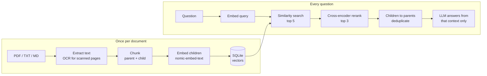

# RAG Retrieval Visualizer

**See what happens inside the retrieval half of a RAG system, one stage at a time.**

Most RAG demos show a question going in and an answer coming out. This project opens the box in between: how a document is split into chunks, turned into vectors, searched, reranked, and assembled into the context a language model finally reads. Every stage is its own step with its own output, so you can follow a question all the way through.

It runs entirely on your own machine (local models, no cloud API keys) and supports sharing over tunnels, with per-browser session isolation and serialized inference to stay stable on limited VRAM.


## How it works



| Stage | What happens |
|---|---|
| **Extract** | Text is read from the PDF's text layer; pages with no text layer are read with Tesseract OCR. |
| **Chunk** | Each document is split twice: large *parent* chunks (~1200 characters) for context, small *child* chunks (~300 characters) for precise search. |
| **Embed** | Each child chunk becomes a vector using a local Ollama embedding model. |
| **Retrieve** | The question is embedded and compared to stored vectors with cosine similarity. The closest candidates move on. |
| **Rerank** | A cross-encoder scores each (question, chunk) pair together and reorders candidates. |
| **Build context** | Selected children are resolved to parent chunks, duplicates removed, and source-labelled context is assembled. |
| **Generate** | A local LLM answers using only that context. |

## Features

- Step-by-step retrieval inspection (retrieve, rerank, context, generate) with before/after views
- Parent/child chunk visualization and extracted-text/OCR preview
- Local-only stack: FastAPI + React + SQLite + Ollama (+ optional Tesseract OCR)
- **Per-session isolation:** each browser session gets its own document library and pipeline workspace via `X-Session-Id`
- **Serialized inference queue:** embeddings, reranking, and generation run one at a time with a short cooldown to avoid overloading limited VRAM (e.g. 6 GB) when multiple users share the backend
- Tunnel-friendly frontend configuration for remote demos

## Tech stack

| Part | Choice |
|---|---|
| Backend | Python 3.11, FastAPI |
| Frontend | React 18, Vite |
| Vector store | SQLite with brute-force cosine similarity |
| Embeddings | Ollama (`nomic-embed-text` by default) |
| Reranker | `cross-encoder/ms-marco-MiniLM-L-6-v2` (sentence-transformers) |
| LLM | Ollama chat model (configurable) |
| OCR | Tesseract via `pytesseract` and PyMuPDF (for scanned PDFs) |

## Prerequisites

- **Python 3.11**
- **Node.js** and npm
- **[Ollama](https://ollama.com)** running locally
- **[Tesseract OCR](https://github.com/UB-Mannheim/tesseract/wiki)** (optional, only for scanned/image PDFs)

## Setup

### 1. Pull models (Ollama)

```powershell
ollama pull nomic-embed-text
ollama pull hf.co/openbmb/MiniCPM5-1B-GGUF:Q4_K_M
```

You can use a different Ollama chat model by changing `LLM_MODEL` in `backend/app/config.py` (or environment).

### 2. Backend

```powershell
cd backend
py -3.11 -m venv venv
venv\Scripts\activate
pip install -r requirements.txt
```

The reranker model (~90 MB) is downloaded on first use and then cached locally.

### 3. Frontend

```powershell
cd frontend
npm install
```

## Running locally

Make sure Ollama is running.

### Option A: One command (recommended)

From the project root:

```powershell
python run.py
```

This starts the FastAPI backend and Vite frontend (reusing them if already running).

- UI: `http://localhost:5173`
- API: `http://127.0.0.1:8000`
- API docs: `http://127.0.0.1:8000/docs`

### Option B: Run separately

```powershell
# Terminal 1 - backend
cd backend
venv\Scripts\activate
python -m uvicorn app.main:app --reload --port 8000

# Terminal 2 - frontend
cd frontend
npm run dev
```

Health check:

```powershell
curl http://127.0.0.1:8000/api/health
```

## Sharing remotely (tunnels)

To let others access the app from their own devices, expose both the frontend and backend and point the frontend to the backend’s public URL.

1. **Start backend** locally on port `8000`.
2. **Expose backend** with a tunnel (e.g. ngrok, pinggy) and copy its public HTTPS URL (e.g. `https://your-backend.example`).
3. **Configure frontend API URL** in `frontend/.env`:

   ```env
   VITE_API_BASE_URL=https://your-backend.example
   ```

   (See `frontend/.env.example`.)
4. **Start frontend** (`npm run dev` or a built preview/server) and expose it with a tunnel URL for users to open.
5. **Restart frontend** after changing `.env` so Vite picks up the new value.

Notes:
- Do not point the frontend at `http://localhost:8000` when users access the frontend via a remote/tunnel URL; browsers will try to reach *their* localhost.
- Backend CORS is currently permissive to simplify tunnel/demo setups.
- Tunnel URLs are temporary; update `frontend/.env` when they change.
- Inference is queued server-side, so simultaneous users may wait briefly for embeddings/reranking/generation to complete.

## Configuration

### Backend (`backend/app/config.py`, overridable via env vars)

| Setting | Default | Meaning |
|---|---|---|
| `OLLAMA_BASE_URL` | `http://localhost:11434` | Ollama server URL |
| `EMBEDDING_MODEL` | `nomic-embed-text` | Embedding model |
| `LLM_MODEL` | `hf.co/openbmb/MiniCPM5-1B-GGUF:Q4_K_M` | Chat/generation model |
| `RERANKER_MODEL` | `cross-encoder/ms-marco-MiniLM-L-6-v2` | Cross-encoder reranker |
| `PARENT_CHUNK_SIZE` / `PARENT_CHUNK_OVERLAP` | 1200 / 100 | Parent chunking |
| `CHILD_CHUNK_SIZE` / `CHILD_CHUNK_OVERLAP` | 300 / 50 | Child chunking |
| `TOP_K` | 5 | Retrieval candidates |
| `RERANK_TOP_N` | 3 | Candidates kept after rerank |
| `TESSERACT_CMD` | local path in config | Tesseract executable path |
| `CORS_ORIGINS` | `*` | Allowed origins (tunnel/dev friendly) |

If you change the embedding model, re-ingest documents because existing vectors are not comparable across embedding spaces.

### Frontend (`frontend/.env`)

| Variable | Example | Meaning |
|---|---|---|
| `VITE_API_BASE_URL` | `https://your-backend.example` | Backend base URL used by the browser |

## API

| Endpoint | Purpose |
|---|---|
| `POST /api/ingest` | Upload and process a document |
| `GET /api/documents` | List documents for the current session |
| `DELETE /api/documents/{id}` | Remove a document |
| `GET /api/documents/{id}/structure` | Parent/child chunk tree |
| `GET /api/documents/{id}/extraction` | Extracted text per page (with OCR flags) |
| `POST /api/retrieve` | Query embedding + vector retrieval |
| `POST /api/rerank` | Rerank candidates |
| `POST /api/build-context` | Resolve children to parent context |
| `POST /api/generate` | Generate answer from context |
| `POST /api/query/full` | Run full pipeline |
| `GET /api/health` | Health check |

Errors include a stage identifier to make failures easier to diagnose.

## Project layout

```
backend/app/
  ingestion/        text extraction (OCR fallback) and chunking
  embeddings/       Ollama embedding client
  store/            SQLite storage and vector search
  retrieval/        retriever, reranker, context builder
  generation/       LLM generation
  inference_queue.py serialized inference with cooldown
  pipeline.py       stage orchestration
  main.py           FastAPI app
frontend/src/       React UI, API client, views
docs/               presentation/supporting notes
```

## Notes and limitations

- Prototype/demo scope: brute-force similarity over SQLite is suitable for small document sets, not large-scale production workloads.
- Supported uploads: `.pdf`, `.txt`, `.md`.
- Session isolation is browser-local (no auth/account system); clearing browser storage or using a different browser creates a new session.
- Inference is intentionally serialized with cooldown for low-VRAM stability, so concurrent users may experience queued wait times.
- Answer quality depends on retrieval quality, model choice, and question specificity.

## Author

Rudra Mistry - [@RudraMistry-cmd](https://github.com/RudraMistry-cmd)
